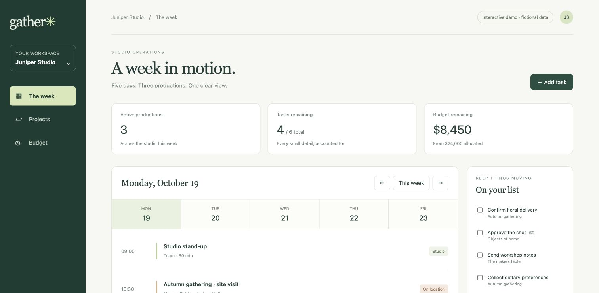
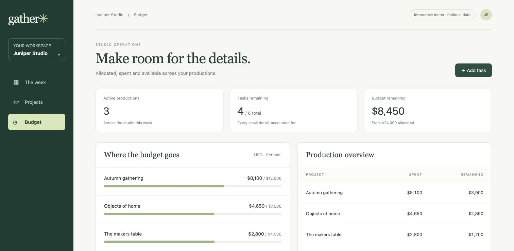

# Gather — studio operations prototype
A newly created, fully AI-built interactive web project, prepared on 22 October 2026 for design review. Juniper Studio, its people, productions and budget figures are fictional. This is a prototype, with no client, revenue or production-use claims.
## Try it
[Open the live interactive preview](https://acatwithebola.github.io/gather-studio-demo/) — no download or account required.
Download `index.html` and open it in a modern browser. It is a single self-contained file with no external libraries, images, fonts, API keys or services. Changes are stored only in that browser. Use **Reset demo data** to restore the examples.
- Switch between the weekly schedule, projects and budget views.
- Select weekdays or use the day-navigation buttons.
- Complete, reopen and add tasks.
- Search projects and change a project status.
- Review the example budget allocations and remaining amounts.
## Preview

## Verification and limits
Browser checks covered task completion and creation, project status updates, project search, day navigation, persistence after reload and reset. Example budget totals reconcile to USD24,000 allocated, USD15,550 spent and USD8,450 remaining. The JavaScript syntax check passed. Responsive layouts are included; mobile-browser testing has not been completed.
No accounts, real customer data, bank connection or payment processing are included. No commercial screenshot or recording licence has been agreed. Any proposed commercial licensing requires a separate written agreement.
